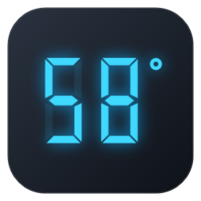
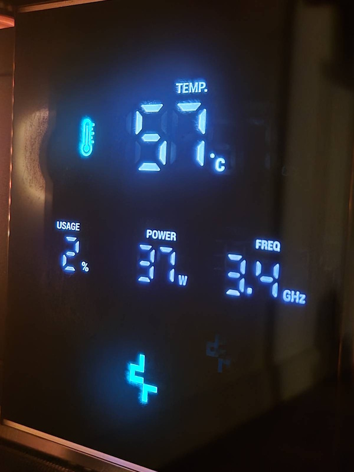
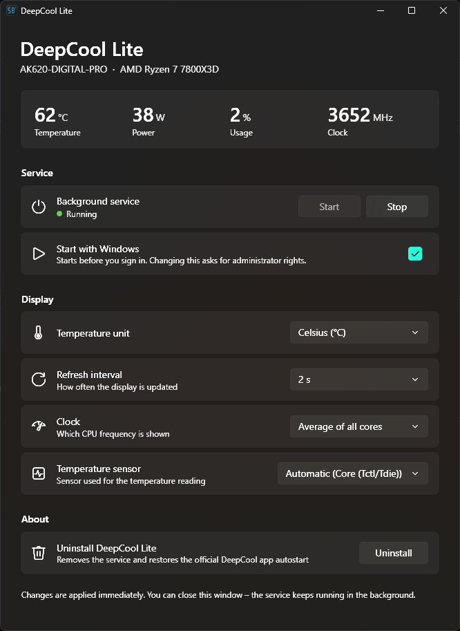
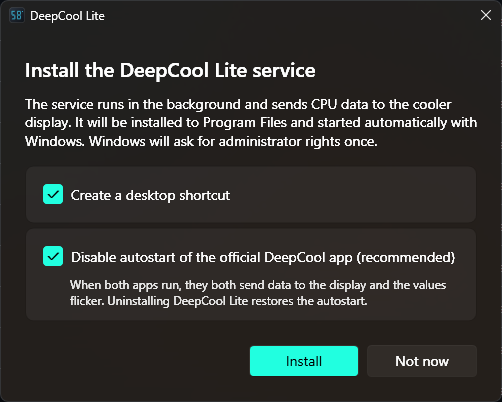

# DeepCool Lite

A lightweight replacement for the official DeepCool app that shows **CPU temperature, power, usage and clock** on the built-in display of DeepCool **AK620 DIGITAL PRO** and **AK500 DIGITAL PRO** coolers.

The official app runs as an Electron app plus a helper service and uses roughly **680 MB of RAM** just to send a few numbers to the cooler once a second. DeepCool Lite does the same job with a small Windows service (about **12 MB private memory**, near-zero CPU). You only open the settings window when you want to change something.

> The cooler's backlight works without any software. You only need an app for the numbers on the display.

<p align="center">
  
  &nbsp;
  
</p>

## Features

- Sends CPU temperature, package power, total usage and clock to the cooler display
- Runs as a Windows service, so no tray icon and nothing to keep open
- Fluent (Windows 11) settings window that follows the system light/dark theme
- Settings:
  - temperature unit: °C or °F
  - refresh interval: 250 ms – 10 s
  - clock source: highest core or average of all cores
  - temperature sensor: Tctl / Package / any CPU sensor reported by the hardware
  - start with Windows
- A single exe: it installs itself, then works as the settings window and updater
- One-click install, update and uninstall (asks for admin via UAC)
- Optionally turns off the official DeepCool app's autostart during install and turns it back on when you uninstall

## Supported devices

| Device | USB ID | Status |
| --- | --- | --- |
| AK620 DIGITAL PRO | `3633:0012` | Tested |
| AK500 DIGITAL PRO | `3633:0011` | Same protocol, untested |

Other DeepCool displays use different packet formats. See [Adding a device](#adding-a-device).

## Download

Get one of these from the [latest release](https://github.com/michalzembron/Deepcool-Lite/releases/latest):

| File | Size | Needs |
| --- | --- | --- |
| `DeepCoolLite.exe` | ~3 MB | [.NET 10 Desktop Runtime](https://dotnet.microsoft.com/download/dotnet/10.0) (x64) |
| `DeepCoolLite-SelfContained.exe` | ~160 MB | nothing, .NET is included |

Both work the same. The self-contained one is just bigger to download.

Requirements:

- Windows 10 or 11, x64
- [PawnIO](https://pawnio.eu/) driver. LibreHardwareMonitor needs it to read CPU temperature, power and clock.

## Installation

1. Run the downloaded exe.
2. Click **Install** and accept the UAC prompt.

<p align="center">
  
</p>

The exe copies itself to `C:\Program Files\DeepCool Lite`, extracts the service next to it, registers and starts the `DeepCoolLite` service and creates a Start menu shortcut (and a desktop one, if you leave it checked). The settings window then reopens from the installed copy, so you can delete the downloaded file. Close the window whenever you like. The service keeps running in the background.

**Update:** run the new version's exe and click **Update** in the *About* section. Your settings are kept.

**Uninstall:** click **Uninstall** in the settings window. This removes the service, the program files and the data folder, and restores the official DeepCool autostart if Lite turned it off.

## How it works

```
DeepCoolLite.exe  ──named pipe──►  DeepCoolLite.Service.exe  ──HID──►  cooler display
 (open when needed)                  (Windows service, SYSTEM)
                                     └─ LibreHardwareMonitor (CPU sensors)
```

- **Service** (`src/DeepCoolLite.Service`) reads CPU sensors with LibreHardwareMonitor, builds a 64-byte HID report and sends it to the display at the chosen interval. It reconnects automatically if the cooler is unplugged.
- **Settings** (`src/DeepCoolLite.Settings`, builds `DeepCoolLite.exe`) is a WPF app. It talks to the service over a local named pipe (`DeepCoolLite`) to show live readings and change settings. The same exe handles install, update and uninstall when elevated. The release build carries the service inside it as an embedded resource.
- **Core** (`src/DeepCoolLite.Core`) holds the shared settings model and IPC contract.

Security notes:

- The pipe accepts only authenticated local users, one small JSON message per connection, with size and time limits.
- Settings are stored in `C:\ProgramData\DeepCool Lite`, which only administrators and SYSTEM can write to.
- Interactive users can start and stop the service without admin rights. Everything else needs elevation.

## Building from source

Requires the [.NET 10 SDK](https://dotnet.microsoft.com/download/dotnet/10.0).

```sh
dotnet build DeepCoolLite.slnx -c Release
dotnet test DeepCoolLite.slnx
```

Both apps are built into `artifacts/Release/`. This development build can't install itself, because the service isn't embedded in it. To get the release exes:

```powershell
./build/publish.ps1          # -> artifacts/publish/DeepCoolLite.exe and DeepCoolLite-SelfContained.exe
```

Pushing a `v*` tag (e.g. `v1.0.0`) makes GitHub Actions build both exes and attach them to a new release.

For debugging you can run the service in a console (as administrator, so sensors are readable) and log every reading:

```sh
artifacts/Release/DeepCoolLite.Service.exe --LogReadings=true
```

## Adding a device

Each display is described by an `IDisplayProtocol` in `src/DeepCoolLite.Service/Devices`:

1. Implement `IDisplayProtocol`: vendor/product IDs, report length and `BuildStatusReport`, which fills the HID report from a `CpuReading`.
2. Add it to `DisplayProtocols.All`.
3. Add tests next to `Ak620ProProtocolTests`.

Pull requests for other DeepCool coolers are welcome, especially if you own the hardware and can test it.

## Credits

- [deepcool-digital-linux](https://github.com/Nortank12/deepcool-digital-linux) by Nortank12. Their documentation of the DeepCool display protocols made this project possible. If you're on Linux, use their project.
- [LibreHardwareMonitor](https://github.com/LibreHardwareMonitor/LibreHardwareMonitor) for CPU sensor access
- [HidSharp](https://www.zer7.com/software/hidsharp) for USB HID communication

## Disclaimer

DeepCool Lite is an independent project. It is not affiliated with, endorsed by or supported by DeepCool. "DeepCool" and product names are trademarks of their respective owners. Use at your own risk.

## License

[MIT](LICENSE) © 2026 Michał Zembroń
